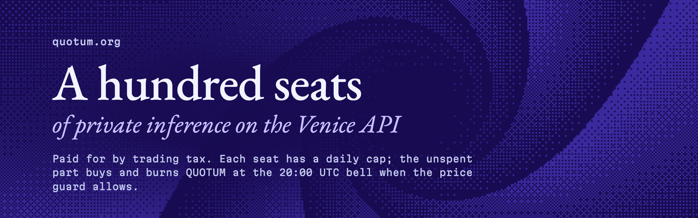
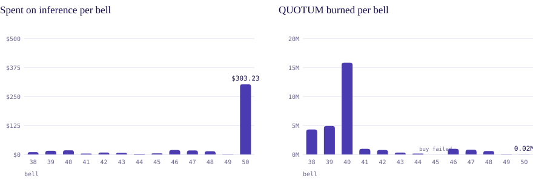

# quotum

a hundred seats for private and anonymized models via the Venice API, paid for by the trading tax of the QUOTUM token on Robinhood Chain. a seat is taken by staking QUOTUM and carries a daily dollar cap. at the 20:00 UTC bell the unspent allowance funds an attempt to buy and burn QUOTUM, when the price guard allows. every bell is a public transaction. the rules are at [quotum.org/docs](https://quotum.org/docs).

## the bell

<picture>
  <source media="(prefers-color-scheme: dark)" srcset="https://raw.githubusercontent.com/qvotvm/.github/main/profile/bells-dark.svg">
  
</picture>

through bell 47 (11 Nov 2026) · 143,101,586 QUOTUM bought and burned, 14.31% of launch supply · $1,121.89 of seat inference · bells 4 and 45 burned nothing. the chart is redrawn from [quotum.org/api/usage.json](https://quotum.org/api/usage.json) after each bell, and each bell's transaction is on [quotum.org/usage](https://quotum.org/usage).

## use a seat

- [quotum.org/seat](https://quotum.org/seat): take or leave a seat. leaving returns the stake and closes the seat.
- [hermes-quotum](https://github.com/qvotvm/hermes-quotum): your seat as a model provider in Hermes Agent, within the seat's cap. `hermes plugins install qvotvm/hermes-quotum --enable`, then `hermes usage` shows cap, spend, what is left and the time to the bell.
- [t.me/qvotvm](https://t.me/qvotvm): the bell card after every bell.

## pay as you go

no seat needed: a prepaid USDG project balance on Robinhood Chain, spent through an OpenAI-compatible endpoint with revocable project access, model and daily limits. a pilot, by invite or by holding at least 0.1% of QUOTUM supply. check the intake status at [quotum.org/docs#payg](https://quotum.org/docs#payg) before funding.

## vote

QUOTUM holders vote on proposals at [quotum.org/governance](https://quotum.org/governance). a ballot is a signed message, not a transaction. receipts are copied to [qip-1-receipts](https://github.com/qvotvm/qip-1-receipts). votes happen only on quotum.org.

## also from quotum

- [quotumorg](https://github.com/quotumorg): the x402 facilitator on Robinhood Chain and the Hermes Agent plugins rh-preflight (with HEY Research Lab), precedent-log and exfilbar.
- [hermes-team-kit](https://github.com/qvotvm/hermes-team-kit): a Hermes Agent team that can't approve its own work. a Telegram gate no model reads, a spend breaker and a daily ledger.
- [copperplate](https://github.com/qvotvm/copperplate): an agent skill for Claude Code, Codex and Hermes that engraves a fictional share certificate for a company you describe in one line.

<a href="https://quotum.org">quotum.org</a> · <a href="https://quotum.org/docs">docs</a> · <a href="https://x.com/quotumorg">X</a> · <a href="https://quotum.org/discord">Discord</a> · <a href="https://t.me/qvotvm">Telegram</a> · issues go to each repo

